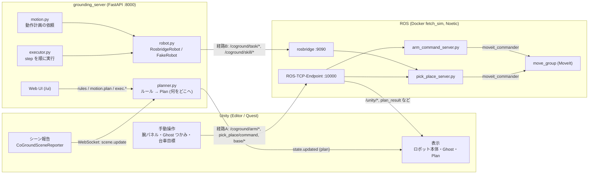
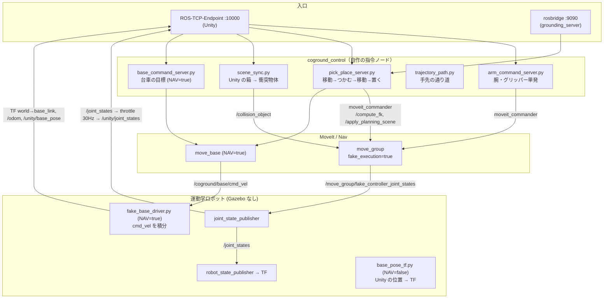
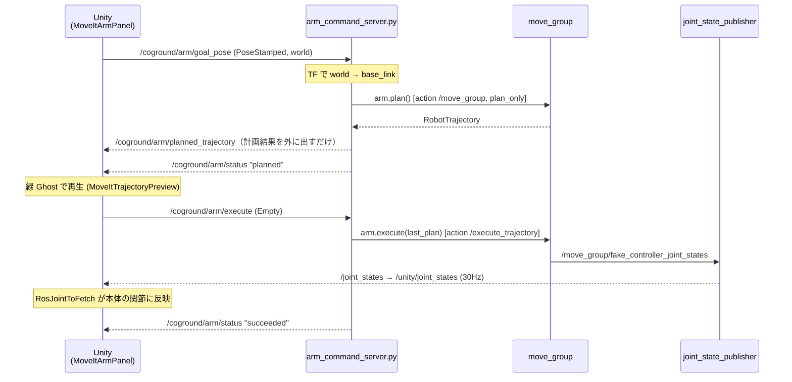
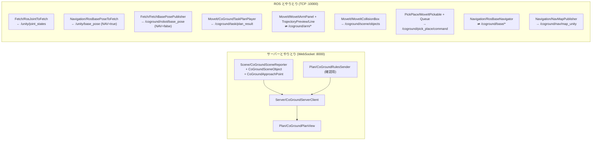
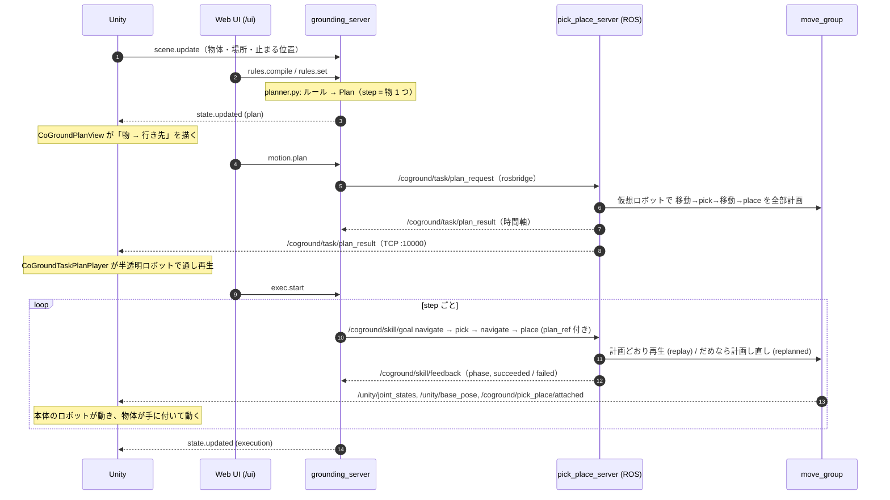

# CoGround 全体の流れ（Unity / grounding_server / ROS）

迷ったときに頭の中で追うための地図。細かい手順・トピックの JSON は次を見る:
`Backend/README.md`（ROS 側）、`grounding_server/README.md`（サーバーとプロトコル）、各スクリプト冒頭の docstring。

---

## 1. 登場人物と 2 本の経路

| 経路 | 通り道 | 使いどころ |
|---|---|---|
| **A: 直結** | Unity ⇄ ROS-TCP-Endpoint (:10000) | 手動操作（腕パネル、Ghost で置き場所指定、台車の目標）と、**表示用のデータすべて**（関節角・台車位置・計画結果） |
| **B: サーバー経由** | Unity → サーバー (:8000) → rosbridge (:9090) → ROS | ルールに基づくタイディ（計画 → 実行）。**いまのメイン** |

経路 B でも、ロボットが動いた結果は経路 A（`/unity/*`）で Unity に表示される。

---

## 2. ROS の中身

### 2.1 ノード構成

起動の入口は `vr_sim.launch` だけ。`NAV` は既定で `true`（`make up` でも台車を ROS 側で動かす）。デモ一式は `make coground`。

### 2.2 自作トピックと MoveIt の関係

`/coground/*` は **MoveIt に直接届くトピックではない**。自作ノードが受け取り、
**`moveit_commander`（MoveIt 公式の Python クライアント）** で move_group の標準 action / service を呼ぶ。
Unity が MoveIt のメッセージ型を生成しなくて済むように、Unity とは標準メッセージ（`PoseStamped`、`Empty`、`String` の JSON など）だけでやりとりする。

腕を 1 回動かす例（`arm_command_server.py`）:

| moveit_commander の呼び出し | 裏で使う MoveIt 標準のもの |
|---|---|
| `plan()` | action `/move_group`（plan_only） |
| `execute()` | action `/execute_trajectory` |
| `stop()` | topic `/trajectory_execution_event` |
| `gripper.go()` | action `/move_group`（計画 + 実行） |

### 2.3 pick_place_server.py の 3 つの入口

| 入口 | 使う人 | 内容 |
|---|---|---|
| `/coground/pick_place/command` | Unity（経路 A） | 箱を指定場所へ運ぶ（手動操作用） |
| `/coground/task/plan_request` → `plan_result` | サーバー（経路 B） | **動かさずに**全 step を計画し、通しで再生できる時間軸（台車・関節・持っている区間）を返す |
| `/coground/skill/goal` → `feedback` / `state` | サーバー（経路 B） | `navigate` / `pick` / `place` を 1 つずつ実行。`plan_ref` 付きなら計画した軌道を再生（`replay`）、だめならその場で計画し直す（`replanned`） |

出力 `/coground/pick_place/attached` が出ている間、Unity は物体をグリッパーに追従させる。

---

## 3. Unity の中身（`Assets/Main/Script/`）

| フォルダ | 役割 |
|---|---|
| `Fetch/` | ロボット本体の表示（関節角）と、NAV=false のときの台車位置の送信 |
| `Navigation/` | 台車。`RosBaseNavigator` / `RosBasePoseToFetch` が NAV=true 用。`BaseNavigator` 系は ROS を使わない旧方式 |
| `MoveIt/` | 腕の手動操作と計画の表示。`CoGroundTaskPlanPlayer` が動作計画を通しで再生（シーケンスバー） |
| `PickPlace/` | Ghost をつかんで離す → そこへ運ぶ（経路 A の手動 Pick & Place） |
| `Scene/` | 物体・場所・止まる位置をサーバーへ（`scene.update`、値は真値） |
| `Plan/` | サーバーの Plan を描く（「物 → 行き先」の弧とラベル） |
| `Server/` | サーバーとの WebSocket |

---

## 4. メインの流れ（経路 B: タイディ）

いまの範囲: 物体の種類・位置・置き場所はシミュレーションの真値が届く。**探索（look_for）はまだ範囲外**で、実行の単位は pick / place（+ navigate）。
`motion.plan` / `exec.*` はいま Web UI から操作する（Unity からは送っていない）。

---

## 5. 混乱しやすい点

| 点 | 中身 |
|---|---|
| **台車の位置を誰が決めるか** | `NAV=false`: Unity（`FetchBasePosePublisher` → `base_pose_tf.py`）。`NAV=true`（`make coground`）: ROS（`fake_base_driver.py` → `/unity/base_pose` → `RosBasePoseToFetch`） |
| **座標** | サーバーは Unity 座標（左手系・Y 上）。ROS は右手系・Z 上、frame `world` = Unity の World。変換は位置 `(x,y,z) → (z,-x,y)`（Unity の `To<FLU>()` と同じ）。サーバーの `robot.py` が ROS に渡すときに変換する |
| **`/coground/*` は MoveIt のトピックではない** | 自作ノードが受けて `moveit_commander` で MoveIt を呼ぶ（2.2） |
| **`plan_types.py` は使われていない** | 中の `/coground/plan/*` はどこからも使われていない。実際は `/coground/task/*`（計画）と `/coground/skill/*`（実行） |
| **手動の経路はメインと別** | `MoveItArmPanel`、Ghost の Pick & Place、`BaseNavigator`（Unity だけの台車）はデバッグ・手動用 |
| **代役ロボット** | サーバーに `COGROUND_ROSBRIDGE_URL` が無いと `FakeRobot` になり、ROS なしで動く（ROS は呼ばれない） |
